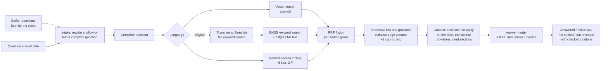

# PermitNav

**A retrieval-augmented assistant for Swedish work-permit and residence rules.** It answers in English or Swedish from Swedish law, Migrationsverket's guidance and Migration Court of Appeal rulings, and every claim cites its source with the date the rule applies from (or the date the page was seen), an exact Swedish quote and an unofficial translation.

It covers work permits (including the EU Blue Card), family members of work-permit holders, permanent residence and EU long-term resident status. Asylum, protection and deportation are out of scope, and it says so.

> **Not legal advice.** PermitNav points to the rules; it cannot predict the outcome of an individual case. Always check with [Migrationsverket](https://www.migrationsverket.se).

**Status:** phases 1–3 of 8 done: baseline RAG, evaluated retrieval and answering, and a deployed, traced, monitored service (private until the public beta). Built with an evaluation-first workflow: every change is measured on a reviewed golden set, and results on held-out questions are reported next to the tuned numbers, including where they fall short.

## An answer

```
$ permitnav ask "I've been laid off. How long do I have to find a new job before my work permit is affected?"

According to Migrationsverket, you can stay in Sweden for three months after your last working day to
look for a new job, but only if your work permit is still valid during that period [S1][S7]. […] The
sources I have do not show this three-month period in the law itself, so treat it as Migrationsverket's
stated practice.

Sources
  [S1] Om du ska byta arbetsgivare eller yrke eller sluta arbeta … › Om du ska sluta jobba
       Migrationsverket's web page as seen on 2026-11-20 | https://www.migrationsverket.se/…#h-Omduskaslutajobba
       "Du har ändå möjlighet att stanna kvar i Sverige i tre månader efter din sista arbetsdag för att söka
        nytt arbete, förutsatt att ditt arbetstillstånd fortfarande är giltigt under den perioden."
       (unofficial translation: You still have the option of staying in Sweden to look for a new job for
        three months after your last day of employment, provided that your work permit is still valid …)
  [S7] If you are going to change employer or profession or stop working … › If you are going to stop working
       …
Källa: Migrationsverket
As of 2026-11-23. Not legal advice; check with Migrationsverket. You are talking to an AI.
```

This real answer also shows the main open problem: the governing law section (7 kap. 3 § utlänningslagen) was not retrieved, and the answer says so instead of inventing it. Law retrieval for questions phrased as situations is what the evaluation below identifies as the weakest part.

## How it works



- **Sources:** utlänningslagen and utlänningsförordningen from the Riksdag's open API (one unit per section, with every wording dated by when it applies), about 230 Migrationsverket pages in Swedish and English (one unit per heading section, linked as translations), 97 in-scope Migration Court of Appeal rulings from the courts' CC0 API, and 15 of Migrationsverket's legal position papers.
- **Time:** every question has an as-of date; only wordings that apply on that date are searched, and transitional provisions are added whenever a section they concern is retrieved.
- **Hybrid retrieval:** vector search and BM25, fused with Reciprocal Rank Fusion, with English questions translated for keyword search (Swedish statute text does not match English words). Law and guidance are interleaved so plain-language pages cannot crowd out the law.
- **Conversations:** a follow-on ("and can my spouse work too?") arrives with the earlier questions, which the client keeps; one cheap model call rewrites it into a complete question in the same language before searching, and the response shows how it was understood. The server stores nothing; a single question makes no extra call.
- **Answering:** the model answers only from numbered sources, separates legal requirements from agency practice, asks one follow-up question when the answer depends on an unknown permit, says when the rules leave something to the case officer, and declines out-of-scope topics. Citations to sources it was not given are removed; quotes must be exact.

## Results

Measured on a reviewed golden set (64 development questions in English and Swedish) and two private hold-out sets, each run once:

| | Development set (tuned on) | Hold-out 1: harder, situational | Hold-out 2: fresh |
|---|---|---|---|
| Retrieval recall@5 | 0.53 (0.32 at the naive baseline) | 0.31 | 0.61 |
| Right kind of answer | ~81% | 58% | 86–91% |
| Judged correct | 81–85% | 61% | 91% |
| Faithful to its sources | 90–100% | 100% | 91–100% |
| Answered in the question's language | 100% | 100% | 100% |

- **The gap is reported, not hidden:** the development numbers were tuned on; the first hold-out showed 20 points less on situational questions, and the diagnosis (law sections missed when a question describes a situation in everyday words) is in [`docs/DESIGN.md`](docs/DESIGN.md), together with the fixes that did not work (a reranker, statute-style query rewriting, a looser "not settled" rule).
- **The judge is evaluated too:** an LLM judge scores correctness against reference answers and faithfulness against the sources in separate calls, calibrated against 30 hand labels and 12 planted errors before use.
- **Cost and latency:** about **$0.0012** and **8 seconds** per question with Claude Haiku 5.5, measured from traces.

### The agentic layer (phase 5), measured before it was built

Each step was measured against plain RAG on the same questions, answer model and judge (88 questions with sources across five golden sets; follow-on questions on 12 multi-turn items), with a stop rule: no step stays on unless answers get better.

| Variant | What changed | Answers | Cost / latency per question | Decision |
|---|---|---|---|---|
| Plain RAG | one search, one answer | 71 of 88 judged correct | $0.0019 / 7.7 s | the default |
| + memory (intake rewrite) | follow-ons made self-contained | multi-turn: right kind 5–6 → 8–11 of 12, needed sources found 2 → 10 of 30 | +$0.0004 / ~+3 s, follow-ons only | **on** |
| + second search (agent loop) | a model checks the evidence and searches again (≤ 2 steps, 3 tools) | law found 60% → 76%, judged correct 71 → 70 (66 with Sonnet checking) | $0.0031 / 10.6 s | off (option) |
| + law descriptions | plain-language descriptions make number-only law findable | situational recall 0.12 → 0.25, but dev 0.52 → 0.47 | $0.39 once | off (option) |
| + verifier (probe) | a model checks cited rules before showing the answer | catches 2 of 7 bad answers, flags 6 of 15 good ones | — | not built |

What the negative results share: the system can be made to find more law, but choosing the right rule among similar ones (the law's general family rules vs. the ordinance's rule for a work-permit holder's family) is the bottleneck, and neither more search nor a checking model fixed it. Details and numbers in [`docs/DESIGN.md`](docs/DESIGN.md) ("Phase 5 plan").

## Engineering

- **Evaluation in CI, without models or keys:** every pull request runs the retrieval eval against a published corpus snapshot with recorded query embeddings, so it is deterministic and works for forks; it fails if recall or MRR drops. After each merge and nightly, a smoke slice of 12 stable golden questions runs with the real model to catch provider drift.
- **Deployment:** one VM in Stockholm (Terraform), Docker Compose behind Caddy (HTTPS), only HTTPS reachable (port 80 redirects), SSH through Google's IAP tunnel, nightly backups the VM can add to but not delete.
- **Deploy on merge, pull-based:** the server checks `main` every five minutes, re-verifies the commit's CI results, deploys, waits for the health check, and rolls back if it fails; GitHub holds no credentials for the server.
- **Observability:** OpenTelemetry traces to Langfuse (EU) with tokens and cost per model call, metadata only in production (no question text leaves the request); uptime checks from six regions and email alerts for downtime, failed backups and failed deploys.
- **Privacy:** EU hosting, no question text in traces or logs, a token-protected API until the beta; provider choices for real users' data are set out in decision D15.

## Repository

| Path | What |
|---|---|
| [`src/permitnav/sources`](src/permitnav/sources), [`parsing`](src/permitnav/parsing), [`corpus`](src/permitnav/corpus) | Fetching (polite, robots-aware), parsing statutes, pages and rulings into dated units, versioned storage and indexing |
| [`src/permitnav/retrieval`](src/permitnav/retrieval), [`answering`](src/permitnav/answering) | Hybrid search, translation, variant collapsing, reranking (optional); context assembly and the answerer |
| [`src/permitnav/evals`](src/permitnav/evals), [`evals/`](evals) | Retrieval metrics, the behaviour and judge evals, replay for CI, the smoke slice; the development golden set |
| [`src/permitnav/api.py`](src/permitnav/api.py), [`tracing.py`](src/permitnav/tracing.py) | The HTTP API and OpenTelemetry tracing |
| [`infra/`](infra), [`deploy/`](deploy) | Terraform, the VM's startup script, production Compose, Caddy, backups, deploy on merge |
| [`docs/DESIGN.md`](docs/DESIGN.md) | Every design decision and measured result, including the negative ones |
| [`ROADMAP.md`](ROADMAP.md) | The eight phases and their "done when" checks |

Python 3.12, FastAPI, PostgreSQL with pgvector, sentence-transformers (bge-m3), OpenRouter for model access during development, OpenTelemetry, Terraform, GitHub Actions.

## Development

Needs [uv](https://docs.astral.sh/uv/) and Docker.

```
cp .env.example .env               # then fill in the keys
docker compose up -d --wait db     # Postgres + pgvector on localhost:5432
uv sync --extra embed --extra api  # Python 3.12 and dependencies
set -a; source .env; set +a        # load the environment
uv run permitnav migrate           # create the schema
uv run permitnav fetch && uv run permitnav ingest && uv run permitnav index
uv run permitnav ask "What salary do I need for a Swedish work permit?"
uv run pytest                      # tests (database tests need DATABASE_URL)
uv run ruff check . && uv run pyright
uv run permitnav eval              # the retrieval eval on the development set
```

For development the CLI runs natively, not in Docker, so the embedding model can use a Mac's GPU. To load the published corpus instead of crawling: `permitnav import-eval-corpus` with the file from the [`eval-corpus` release](https://github.com/bxljoy/permitnav/releases).

### Run the API

```
docker compose up -d --wait        # Postgres + the API on localhost:8000 (first start
                                   # downloads bge-m3, ~2.3 GB, into a volume)
curl -X POST localhost:8000/ask \
  -H "Authorization: Bearer $API_TOKEN" -H "Content-Type: application/json" \
  -d '{"question": "What salary do I need for a Swedish work permit?"}'
```

`POST /ask` takes `{"question": …, "as_of": "YYYY-MM-DD"}` (the date defaults to today) and returns the answer kind, text, citations with dates and links, source credits and the AI notice; a failed model call or an unreadable reply is a 502. `GET /health` checks the database. Every `/ask` needs the `API_TOKEN` from `.env`.

## How it was built

Designed and directed by its author and implemented with [Claude Code](https://claude.com/claude-code) (commits are co-authored). Each slice of work followed the same loop: a written design, implementation with tests, a measured result on the golden set, an independent code review whose findings were fixed with regression tests, and a pull request gated by CI. The reasoning behind each step, including what did not work, is recorded in [`docs/DESIGN.md`](docs/DESIGN.md).

## Sources and licence

Statute text: Källa: Sveriges riksdag. Migrationsverket's text: Källa: Migrationsverket. Court rulings: Sveriges Domstolar (CC0). The repository ships the crawler, not the crawled content; the corpus snapshot published for CI holds current public source text only.

Code: [AGPL-3.0](LICENSE). Contributions require agreeing to a contributor licence agreement; see the repository rules in the roadmap.
